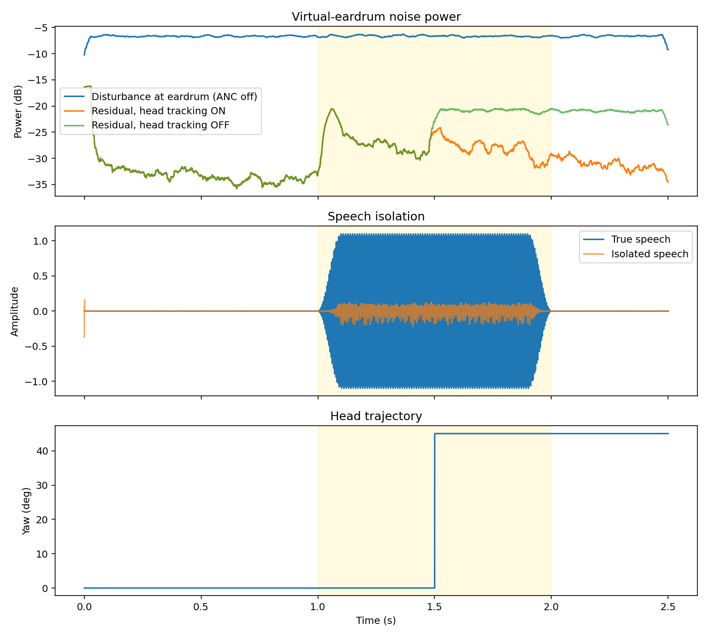

# SAVS-ANC

**Spatially Adaptive Virtual-Sensing Active Noise Cancellation** — a self-contained Python simulation of a headphone ANC architecture that cancels noise at the *eardrum* (a virtual location) rather than at the physical error microphone, adapts to head rotation, and protects conversational speech from being cancelled.



## What it implements

| # | Block | Where |
|---|-------|-------|
| 1 | Dual-mic front end: delay-and-sum beamformer + band-energy VAD mask; speech-band component is removed from the ANC reference so speech isn't cancelled | `src/savs_anc/speech.py` |
| 2 | Head tracking: virtual secondary path `Ŝv(z, θ)` interpolated between 0° and 45° calibrations from head yaw | `controller.py` |
| 3 | Remote-microphone virtual sensing via Internal Model Control: reconstructs the unattenuated disturbance at the physical mic, maps it to the eardrum with `Mv(z) ≈ Pv(z)/Pm(z)`, and forms the virtual error `êv(n)` | `controller.py` |
| 4 | Normalized **leaky** FxLMS, so weights stay bounded during low-excitation periods | `controller.py` |

See [`docs/ARCHITECTURE.md`](docs/ARCHITECTURE.md) for the signal flow and equations.

## Quick start

```bash
git clone https://github.com/<you>/savs-anc.git && cd savs-anc
pip install -e ".[dev]"
savs-anc-sim                      # prints metrics + head-tracking ablation
python examples/run_simulation.py # also writes results/simulation.png
pytest -q
```

```python
from savs_anc import run_simulation
result = run_simulation(track_head=True)
print(result.metrics)
```

## Results (synthetic plants, seed 42)

| Metric | Value |
|---|---|
| Virtual-eardrum attenuation, converged (0.5–1.0 s) | **27.4 dB** |
| Physical-mic attenuation, converged | 20.3 dB |
| Virtual attenuation after 45° head turn, tracking **ON** | **24.3 dB** |
| Virtual attenuation after 45° head turn, tracking **OFF** | 14.3 dB |
| Speech isolation correlation (1.2–1.8 s) | 0.66 |

Positive dB = noise reduced. Numbers are from simulated FIR plants, not measured acoustics.

## Changes from the original prototype

The original script (kept in [`legacy/`](legacy/original_gemini_prototype.py)) ran but **amplified** noise by ~28 dB (reported as −27.8 dB attenuation). Three bugs were fixed:

1. **Invalid observation filter.** `signal.deconvolve(p_v, p_m)` on equal-length arrays returns a *single tap*, so `Mv(z)` was wrong and the virtual-sensing estimate was garbage. Replaced with a ridge least-squares FIR design (`ls_deconvolve`).
2. **Plants didn't pass the noise.** The synthetic paths were band-pass 400 Hz–3.2 kHz, but the noise lives at 120/240 Hz. They are now low-pass with realistic delay; the primary path is longer than the secondary path so the controller is causal.
3. **VAD was stateless.** It computed an "SNR" from a single sample and subtracted the *entire* beamformed signal (noise included) from the reference. It is now a streaming, smoothed band-energy detector that removes only the speech-band component.

Also: the sim now has a head-tracking on/off ablation, a seeded RNG, and unit tests.

## Known limitations

- **Speech isolation is weak.** The isolated-speech signal tracks the speech envelope (corr. 0.66) but at roughly 10% of its amplitude, so a meaningful part of the speech still reaches the ANC reference. A proper VAD/separator (spectral or learned) is the main next step.
- The driver output isn't fed back into the error path, so speech playback is not modelled as an error-mic disturbance.
- Two-point (0°/45°) linear interpolation of an FIR path; no 6-DoF tracking, no measured HRTFs/plants.
- Single-sample Python loop — an algorithm study, not a real-time implementation (the "<50 µs" budget in the original comment is not measured here).
- Both mics see nearly coherent noise (2 cm spacing), so the beamformer provides little spatial discrimination; the VAD is effectively spectral.

## Layout

```
src/savs_anc/   controller.py  speech.py  plants.py  simulation.py
tests/          unit + integration tests
examples/       run_simulation.py  (figure)
docs/           ARCHITECTURE.md
legacy/         original prototype, unchanged
```

## License

MIT
